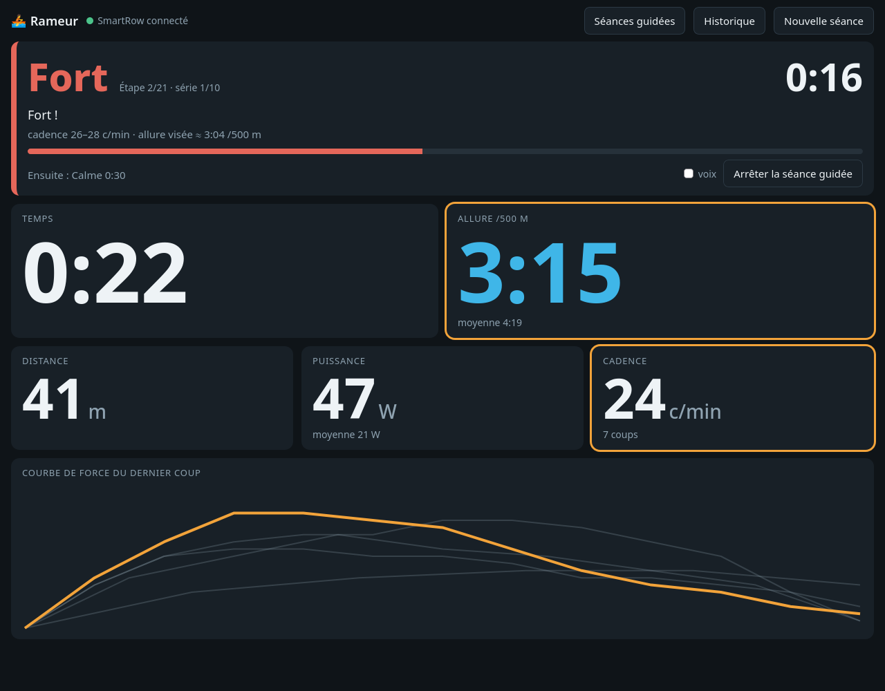
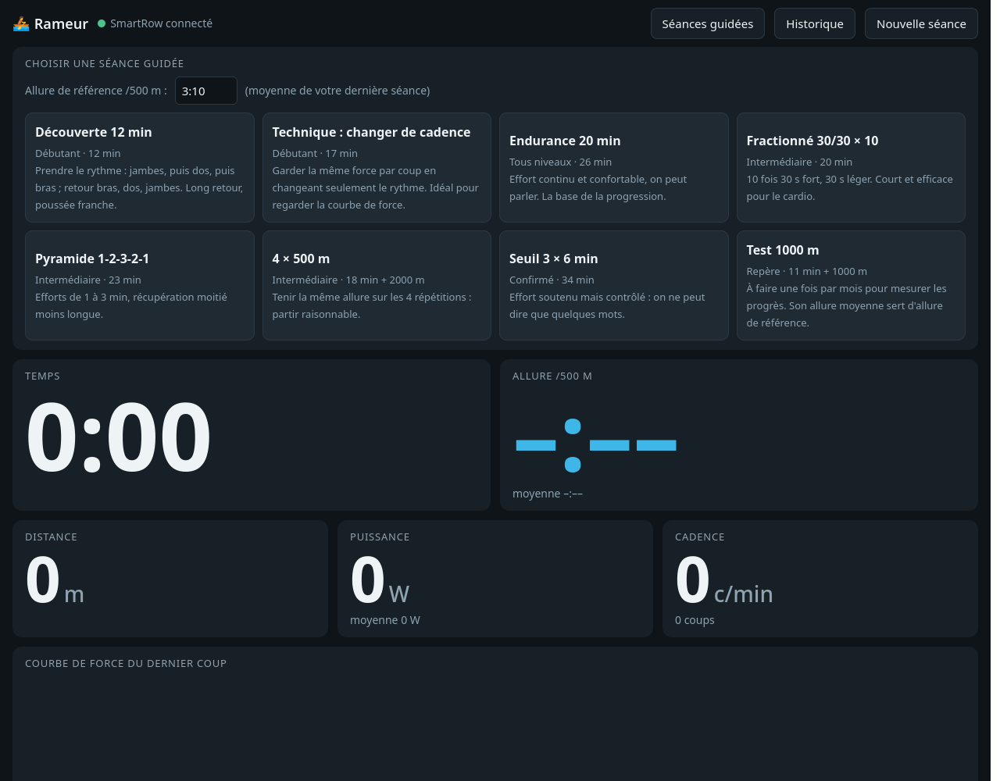
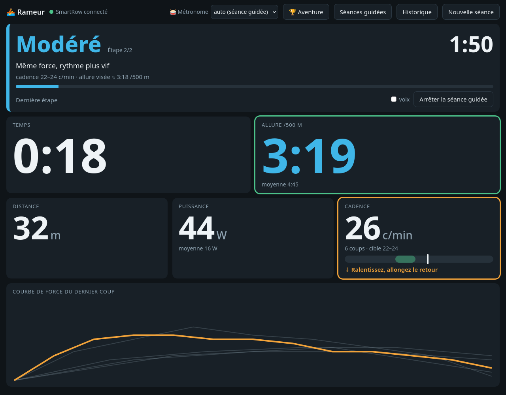
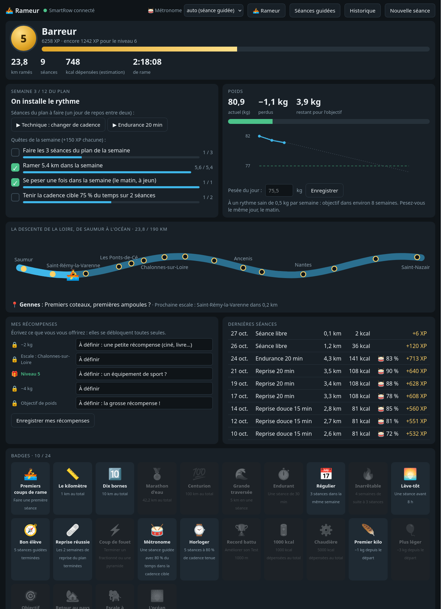

# linux-smartrow-waterrower

**Une application de rameur pour Linux, avec un WaterRower équipé du capteur
SmartRow.**

L'application lit le SmartRow en Bluetooth et affiche la séance en direct dans
le navigateur. On peut l'utiliser sur le PC, ou sur une tablette ou un
téléphone posé devant le rameur. Elle propose aussi des **séances guidées**,
avec consignes vocales, bips et **métronome de cadence**, ainsi qu'un **mode
Aventure** pour rester motivé : niveaux, descente de la Loire, badges,
quêtes, suivi du poids et récompenses personnelles. Elle propose aussi des
séances **hors rameur** (gainage du ventre, mobilité de cheville) et des
**idées de repas** riches en protéines. Tout est enregistré sur l'ordinateur : aucun
compte ni service en ligne n'est nécessaire.

Projet non officiel, sans lien avec WaterRower ni SmartRow.



## Ce qui s'affiche

- **Temps** et **allure /500 m**, en très gros pour être lisibles depuis le
  rameur ;
- **distance**, **puissance** (actuelle et moyenne), **cadence** et nombre de
  coups ;
- **courbe de force** de chaque coup : le dernier en orange, les précédents
  en gris, pour voir la régularité ;
- **historique** des séances : date, type de séance, distance, temps, allure
  et watts moyens.

## Séances guidées



| Séance | Niveau | Contenu |
|---|---|---|
| Reprise douce 15 min | Reprise | 4 min calme, 8 min facile, 3 min calme, cadence 16–20, conseils pour la cheville |
| Reprise 20 min | Reprise | 2 × 5 min faciles, avec une pause en ramant |
| Découverte 12 min | Débutant | 3 min calme, 6 min facile, 3 min calme |
| Technique : changer de cadence | Débutant | Alternance 18–20 / 22–26 c/min avec la même force : on regarde la courbe |
| Endurance 20 / 30 / 40 min | Tous niveaux | Longue, facile et régulière : la base de la progression et de la perte de poids |
| Fractionné 30/30 × 10 | Intermédiaire | 10 × (30 s fort / 30 s léger) |
| Pyramide 1-2-3-2-1 | Intermédiaire | Efforts de 1 à 3 min, récupération moitié moins longue |
| 4 × 500 m | Intermédiaire | Tenir la même allure sur 4 répétitions, 2 min de repos |
| Seuil 3 × 6 min | Confirmé | Effort soutenu et contrôlé |
| Test 1000 m | Repère | Une fois par mois pour mesurer les progrès |

Comment ça marche :
- La séance démarre **au premier coup**.
- Chaque étape donne une **zone d'effort** (calme, facile, modéré, soutenu,
  fort, repos), une **cadence cible** et une **allure visée**.
- L'allure visée est calculée à partir de **votre allure de référence** :
  par défaut, la moyenne de votre dernière séance. Après un *Test 1000 m*,
  mettez son allure moyenne comme référence.
- Les tuiles **Cadence** et **Allure** sont entourées de vert quand vous êtes
  dans la cible, d'orange sinon.
- Une voix annonce chaque étape, avec des bips à 3-2-1. La voix peut être
  coupée.

## Suivre la bonne cadence



- Chaque étape guidée a une **cadence cible**, par exemple 22–24 coups/min.
- La tuile **Cadence** affiche une jauge : la zone verte est la cible,
  l'aiguille montre votre cadence. Un conseil s'affiche dessous :
  *« Accélérez un peu »*, *« Ralentissez, allongez le retour »* ou
  *« Cadence parfaite »*.
- **Métronome** (en haut de l'écran) :
  - un « tic » marque l'attaque, un « toc » plus doux la fin de la poussée,
    pour respecter le rythme 1/3 de poussée, 2/3 de retour ;
  - en mode *auto*, il suit la cible de chaque étape ;
  - on peut aussi choisir une cadence fixe de 18 à 30 pour une séance libre.
- Pendant une séance guidée, l'application mesure le **% du temps passé
  dans la cible**. Ce pourcentage rapporte jusqu'à 100 XP, des badges
  (*Métronome*, *Horloger*) et une quête de la semaine.

Repères de cadence :

| Cadence | Usage |
|---|---|
| 16–20 | échauffement, retour au calme, reprise |
| 20–22 | endurance, perte de poids : l'allure qu'on tient longtemps |
| 22–26 | effort soutenu, seuil |
| 26–30 | fractionné, sprint |

Le mieux est de ramer **long et puissant** plutôt que vite : la puissance
vient des jambes, pas du nombre de coups.

## Hors rameur : ventre et cheville

Ces séances guidées se font au sol, avec un minuteur, la voix et les bips.
Elles ne comportent **aucun saut**, pour ménager une cheville fragile.

| Séance | Contenu |
|---|---|
| Mobilité cheville 5 min | cercles, alphabet avec le pied, montées sur pointes, équilibre, étirement des mollets |
| Renfo ventre 10 min | bascule du bassin, planche sur les genoux, dead bug, planche latérale, pont fessier, relevés de buste, respiration abdominale |
| Renfo ventre 15 min | niveau 2 : planche, bird dog, ciseaux, superman… (à partir de la semaine 5) |

Elles rapportent de l'XP, les badges *Gainé*, *Sangle d'acier* et
*Cheville solide*, et comptent pour une quête de la semaine. Le gainage
renforce la sangle abdominale. Le ventre, lui, s'affine avec la perte de
poids globale : rame et alimentation.

## Idées de repas

Le mode Aventure propose chaque jour une **recette riche en protéines, de
saison, simple et sans poisson ni fruits de mer**, avec un bouton pour en
voir une autre ou la liste complète. On y trouve par exemple :
- un curry de lentilles ;
- un chili ;
- de la dinde avec de la butternut ;
- un velouté de potimarron aux œufs ;
- un gratin de chou-fleur au jambon ;
- du tofu au brocoli ;
- un bol de fromage blanc à la poire…

La liste est dans [`recettes.json`](recettes.json) et se complète
facilement.

## Mode Aventure



*Capture faite avec des données d'exemple.*

- **XP et niveaux**, de *Moussaillon* à *Légende de la Loire*. On gagne de
  l'XP avec la distance, les séances terminées, les séances du plan, la
  cadence tenue, les quêtes et les badges.
- **La descente de la Loire** : les kilomètres ramés font avancer un bateau
  de Saumur à Saint-Nazaire, en 190 km et 16 escales (distances
  approximatives).
- **Plan « Retour en forme » sur 12 semaines** :
  - 3 séances de rame par semaine, plus 2 séances hors rameur les autres
    jours ;
  - **2 semaines de reprise douce** au début, prévues pour un retour de
    blessure ;
  - puis de l'endurance de plus en plus longue, la plus efficace pour
    perdre du poids, et un peu de fractionné ;
  - les séances de la semaine se lancent en un clic.
- **Quêtes de la semaine** : faire les 3 séances du plan, une distance qui
  augmente chaque semaine, tenir la cadence, se peser.
- **24 badges** : distance, régularité, lève-tôt, record au test 1000 m,
  kilos perdus, escales…
- **Poids** :
  - pesée hebdomadaire ;
  - courbe comparée à un rythme sain de 0,5 kg par semaine ;
  - estimation des kcal dépensées (formule ACSM).
- **Mes récompenses** : vous écrivez ce que vous vous offrirez à −2 kg, à
  l'escale de Chalonnes, au niveau 5… Elles se débloquent toutes seules,
  avec des confettis.

Le profil et les pesées restent sur l'ordinateur, dans `donnees/`, qui n'est
pas publié. Les règles du jeu sont dans [`jeu.json`](jeu.json) et faciles à
modifier.

> Le rameur aide, mais la perte de poids se joue surtout dans l'assiette et
> la régularité. Après une blessure, reprenez doucement et arrêtez en cas de
> douleur. En cas de doute, demandez l'avis d'un médecin ou d'un
> kinésithérapeute.

Les séances sont décrites dans [`programmes.json`](programmes.json) et
faciles à modifier. Une étape dure un temps (`temps`, en secondes) ou une
distance (`distance`, en m), et un bloc `repeter` répète des étapes.
Commencez doucement. En cas de problème de santé, demandez l'avis d'un
médecin avant les séances intenses.

## Installation

Il faut Linux avec Bluetooth (BlueZ), Python 3.9 ou plus récent, et un
navigateur.

```
git clone https://github.com/urruck/linux-smartrow-watterrower.git
cd linux-smartrow-watterrower
bash installer.sh      # installe la bibliothèque Bluetooth « bleak » dans lib/
bash rameur.sh         # lance l'appli et ouvre http://localhost:8765
```

- **Fermez l'appli SmartRow du téléphone** : le capteur n'accepte qu'une
  connexion à la fois.
- Tirez sur la poignée pour réveiller le capteur. Le programme le trouve et
  s'y reconnecte tout seul.
- **Ne l'appairez pas** dans les réglages Bluetooth. Sous Linux, un
  appairage gardé en mémoire fait échouer la connexion. Pour le retirer :
  `bluetoothctl remove <adresse>`.
- `bash rameur.sh --reseau` rend la page visible depuis une tablette ou un
  téléphone du même Wi-Fi, à l'adresse `http://<ip-du-pc>:8765`.
- **Nouvelle séance** enregistre la séance en cours et remet le compteur à
  zéro.
- Les séances sont enregistrées dans `sessions/`, au format JSON, avec un
  relevé par seconde et la courbe de chaque coup.

Pour essayer sans rameur, on peut rejouer une vraie séance enregistrée :

```
python3 rameur.py --rejouer exemples/seance-260m.log
```

## Fichiers

| Fichier | Rôle |
|---|---|
| `rameur.py` | application : Bluetooth, petit serveur web, enregistrement |
| `page.html` | l'affichage dans le navigateur, avec les séances guidées |
| `programmes.json` | les séances guidées |
| `jeu.py`, `jeu.json` | mode Aventure : XP, niveaux, parcours, badges, quêtes, plan, poids |
| `recettes.json` | idées de repas protéinés de saison |
| `smartrow_ble.py` | connexion au SmartRow et décodage des messages |
| `ecouter.py` | outil de diagnostic : affiche et enregistre les messages bruts |
| `exemples/seance-260m.log` | une vraie séance enregistrée, pour les essais |

## Protocole SmartRow (V2, vérifié le 27/10/2026 sur une vraie séance)

Service BLE `0x1234`, écriture `0x1235` (un octet à la fois), notifications
`0x1236`. Initialisation `$` puis `\rV@\r` (remise à zéro), puis `$` toutes
les 1,5 s. Messages de 16 caractères + CR, en boucle (~11 par seconde) ;
les 2 derniers caractères = somme des 14 premiers octets en hexadécimal.

| Type | Contenu (indices de caractères) |
|---|---|
| tous sauf f | `[1:6]` distance en m |
| `a` | `[6:11]` temps écoulé : minutes sur 3 chiffres + secondes |
| `b` | `[7:11]` travail du coup /10 (J), `[11:14]` longueur du coup (unité ?) |
| `c` | `[6:9]` watts, `[9:14]` watts moyens /10 |
| `d` | `[6:9]` cadence /10 (coups/min), `[9:13]` nombre de coups |
| `e` | `[6:9]` allure /500 m (m ss), `[9:12]` allure moyenne |
| `f` | `[1:7]` distance en dm, `[7:11]` valeur inconnue, `[11]` = `!` à l'arrêt |
| `x` `y` `z` | courbe de force : 3 × 8 points, caractère − 33 |

Sources : logiciels libres QZ (qdomyos-zwift) et pirowflo, corrigés à
partir d'une vraie séance. Les SmartRow V3 ajoutent un défi
d'authentification (géré, non testé).

## Licence

Copyright © 2026 Yvan Godreau. Logiciel libre sous licence
[GNU GPL v3](LICENSE) ou ultérieure.
